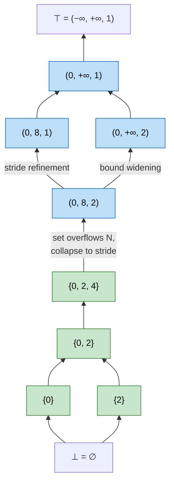
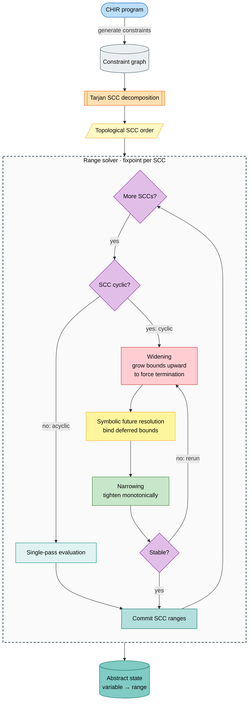

# CheeseBread Analysis

- UFMG Compiler's Lab

## Cangjie and range analysis

[Cangjie](https://cangjie-lang.cn/) is a general-purpose, statically typed language designed for application development across several computing environments. CheeseBread extends the Cangjie compiler with an integer range analysis pass that runs over CHIR, the compiler's intermediate representation.

A range analysis over-approximates the possible values of each integer variable at every program point. That information lets the compiler answer questions that constant or conventional interval analysis may miss, such as whether a loop has reached a stable bound or whether a branch is unreachable. It can also support downstream optimizations, including dead-branch elimination and more precise integer operations.

<!-- Small example with identified ranges -->

```cj
func foo() {
    var i = 0           // i ∈ {0}
    while (i < 10) {
        i++             // i ∈ [0,9:1]
    }
    if (i != 10) {      // i ∈ {10}
        println("dead") // i ∈ ∅ (⊥)
    }
}
```

## Abstract domain

The integer domain combines finite sets with strided intervals. The exact set $\{v_1, \ldots, v_k\}$ records constants while $k \leq N$, where `INT_VALUE_SET_SIZE` controls $N$. Once the set limit is exceeded, the value collapses to an interval

$$
[l, u : s] = \{l, l+s, l+2s, \ldots, u\},
$$

with lower bound $l$, upper bound $u$, and stride $s \geq 1$. Bounds may be constants or $\pm\infty$. Booleans use a separate abstract value.

The lattice is ordered by precision: $\bot$ is the empty set, finite sets and strided intervals describe successively less precise states, and $\top = (-\infty,+\infty:1)$ accepts every integer. Joining values enlarges the approximation. A set can grow until $N$ is reached, after which the implementation derives a strided interval from the GCD of its values.



## Constraint extraction

Range analysis is formulated as a system of dataflow constraints over SSA variables. `CompetitionRangeAnalysis` traverses CHIR values and adds equations to a `ConstraintGraph`; helper constraints for constants such as `0` and `true` are inserted explicitly.

The solver currently models assignments and constants, SSA $\phi$ nodes, arithmetic and comparisons, intersections with bounds, and related integer operations. The principal constraint kinds include:

- `InitializationConstraint`: $x = c$, for an integer constant $c$.
- `InitializationIntegerTop`: initializes a variable to the Cangjie `Int64` top range.
- `PhiConstraint`: $x = \phi(x_1, \ldots, x_k)$ joins values from multiple control-flow predecessors.
- `IntersectionConstraint`: $x = y \cap [l,u]$, with bounds that may reference another variable symbolically.
- Arithmetic and comparison constraints: equations that evaluate expressions using abstract integer or Boolean values.

## Solver pipeline

<details>
<summary><strong>Range Analysis pipeline</strong> (click to expand)</summary>



</details>

The constraint graph is decomposed with Tarjan's algorithm and reversed into topological order, so producers are evaluated before consumers. Each strongly connected component is solved independently:

1. **Growth analysis** repeatedly evaluates every constraint and joins newly discovered values. Set limits and widening delays control how precision is reduced.
2. **Future resolution** replaces symbolic intersection bounds, such as bounds derived from another variable, with the values currently known for that variable.
3. **Narrowing analysis** reevaluates constraints from a bottom state and intersects the result with the previously widened state. This recovers tighter bounds while the domain is moving toward a fixed point.

The result is a sound over-approximation of the values reaching each analyzed SSA variable.

## Benchmarks and validation

The test harness under `test/` exercises the analysis with static assertions (`sassert`). These assertions have no runtime meaning; they describe properties that range analysis should prove after compilation.

- `test/handmade/`: small programs designed to expose individual behaviors such as loops, arithmetic, arrays, recursion, and control-flow merges.
- `test/flavors/`: focused widening and narrowing cases. For example, `fudge.cj` verifies that `i` is exactly `10` after a bounded loop.
- `test/wcet/`: real-time and worst-case execution benchmark programs adapted from the WCET benchmark collection. They cover nested loops, sorting, digital filters, matrix operations, bit operations, recursion, and generated control flow.
- `test/CangjieBench/`: 164 Cangjie programs used to measure analysis scale and code generation success across larger source inputs.

Run a suite after building the compiler:

```bash
./test/run_all.sh all
./test/run_all.sh handmade
./test/run_all.sh wcet
./test/run_all.sh flavors
./test/run_all.sh cangjiebench
```

The harness compiles each case with `-O2 -j1`, reports static assertion failures, and compares expected output for handmade cases that provide `expected.txt`. WCET cases receive a generated input file and CangjieBench programs are compiled as static libraries.

Set-size sensitivity can be measured with `evaluate_set_size.sh`. It rebuilds the compiler for exact-set capacities $1,2,4,8,16,32,64$, runs `test/CangjieBench/compile.sh` for each capacity, and writes `results-N.csv` files containing variable counts, constraint counts, bitwidth reduction, and analysis time.

## Setup

- Prerequisites
  - Python3
  - Clang-{16,18,20}
- [reference](https://gitcode.com/Cangjie/cangjie_build/blob/main/doc_en/linux.md)
- Initialize submodules

```bash
git submodule update --init --recursive
cd cangjie_runtime
git checkout v1.2.0-beta.02
```

- Run the setup script. `./setup.sh`

## Documentation

A full account of the range analysis algorithm implemented in this repository is available in this [technical report](https://lac-dcc.github.io/pubs/TechReports/LaC_TechReport032026.pdf). How to cite:

```bib
@techreport{Borges26,
  title        = {Cangjie Range Analysis},
  author       = {Bernardo Borges and Elisa Frohlich and Vinicius Silva and Rafael Paniago and Pereira, Fernando Magno Quint{\~a}o},
  year         = {2026},
  institution  = {The Federal University of Minas Gerais},
  number       = {03/2026},
  url          = {https://lac-dcc.github.io/pubs/TechReports/LaC_TechReport032026.pdf}
}
```
